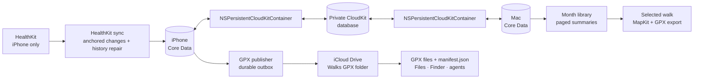

# Walks GPX

### The walk ends. The line stays.

A walk is more than a number in a ring. It is the road you took, the turn you missed, the long way home. Health keeps the record. Walks GPX gives the route a life outside the workout.

On iPhone, it reads your walking workouts and GPS routes from HealthKit. It keeps them in a library you can search and browse by month. Open a walk and the map gives you the whole line, on real streets, with the start and finish where they belong. Export it as GPX and take it with you.

The Mac app gives that history a wider view. And the iCloud Drive folder gives your routes to you—not just to the app. The files are ordinary GPX. The manifest is ordinary JSON. Your walks stay yours.

> One quiet job: find the route, keep it safe, make it useful.

## What it does

- **Reads HealthKit on iPhone.** Walks GPX requests read access to walking workouts and workout routes. It never writes workouts to Health.
- **Keeps the whole walk history.** An anchored HealthKit query handles new changes. A resumable history pass fills gaps. A workout remains in the library even when HealthKit has no readable GPS route for it.
- **Syncs the library between iPhone and Mac.** Each app keeps a local Core Data store. `NSPersistentCloudKitContainer` mirrors those records through your private CloudKit database; delivery happens asynchronously.
- **Keeps browsing light.** The library pages through dates and route availability. It does not decode GPS tracks or load maps while you scroll. The selected walk gets one interactive MapKit route.
- **Publishes portable files.** The iPhone writes GPX routes and a `manifest.json` index to the **Walks GPX** folder in iCloud Drive. Files, Finder, and other tools can read them.
- **Exports only when asked.** Share or save a GPX from a selected route. No eager file generation for every row.
- **Imports GPX on Mac.** Open files and save a copy. Imports are session-only; the Mac does not write imported tracks into the synced walk archive.

## One archive, two roads out

The Mac cannot read HealthKit. The iPhone is the reader; the shared CloudKit database carries the app library to the Mac. iCloud Drive is a separate file mirror for GPX and the manifest. These paths serve different needs and neither is a substitute for the other.



The database path carries walk records and route payloads between the apps. The Drive path carries portable files to the places you choose to use them. A completed local write does not guarantee that iCloud has finished uploading; the app reports pending delivery rather than pretending otherwise.

## Built for a long history

The list is not a stack of maps. It is a clean index into your walks: date, time, duration, and whether a route is available. Month counts come from metadata. Pages use a stable cursor. The route stays asleep until you open it.

That matters when your archive holds thousands of walks. It also keeps the honest cases honest: a workout with no readable route remains visible, but it does not grow a fake map or spin forever. If a route later becomes available, it upgrades the same workout instead of creating a second one.

The underlying rules are documented in [the architecture guide](docs/architecture.md), [HealthKit sync](docs/healthkit-sync.md), [persistence](docs/persistence.md), and [the walk-library design](docs/walk-library-redesign.md).

For the idea that started this project—turning a lifetime of routes into a
map of the city—read the [Walked Here field guide](https://charlesponti.github.io/WalksGPX/).
It explains GPS fixes, route geometry, heatmap metrics, spatial grids, and the
full path from data to map in five short lessons.

## Run it

You need macOS, Xcode, XcodeGen, and an Apple Developer team for a signed iPhone build. The Xcode project is checked in; `project.yml` is its source configuration.

```sh
xcodegen generate
open WalksGPX.xcodeproj
```

In Xcode, select the **WalksGPX iOS** scheme, choose your signing team, and run it on an iPhone. Connect Health and allow access to Workouts and Workout Routes. For the Mac app, sign in with the same Apple Account and give CloudKit time to deliver the library.

The configured bundle identifiers are `io.ponti.walksgpx.ios` and `io.ponti.walksgpx.macos`. The shared CloudKit container is `iCloud.io.ponti.walksgpx`. Your signing team must have those capabilities and container enabled.

## Test it

```sh
# iPhone app and unit tests (choose an installed simulator)
xcodebuild test \
  -project WalksGPX.xcodeproj \
  -scheme 'WalksGPX iOS' \
  -destination 'platform=iOS Simulator,name=iPhone 17'

# Mac app and unit tests
xcodebuild test \
  -project WalksGPX.xcodeproj \
  -scheme 'WalksGPX macOS' \
  -destination 'platform=macOS'
```

The last full coverage runs passed **118 iOS tests** and **57 Mac tests**. App-target line coverage was **90.06% on iOS** and **90.71% on macOS**. Tests exercise sync state, route processing, persistence, paging, map geometry, manifest publishing, and UI state. They cannot prove access to your actual HealthKit history or real cross-device CloudKit delivery; that still needs a signed iPhone and Mac.

## Know the boundaries

This is a personal-data prototype. HealthKit permission state is intentionally opaque: iOS does not let the app distinguish “read denied” from “there is no data.” A workout can exist without a GPS route. Background sync is best-effort, and CloudKit delivery is asynchronous.

The app uses your private CloudKit database and iCloud Drive. Review Apple’s current HealthKit and CloudKit requirements before distributing it beyond personal use. Keep the iCloud Drive export as a portable fallback until your Mac has received and verified the historical archive.

For the operational details and sharp edges, start with [Development and verification](docs/development.md) and [Gotchas](docs/gotchas.md).
